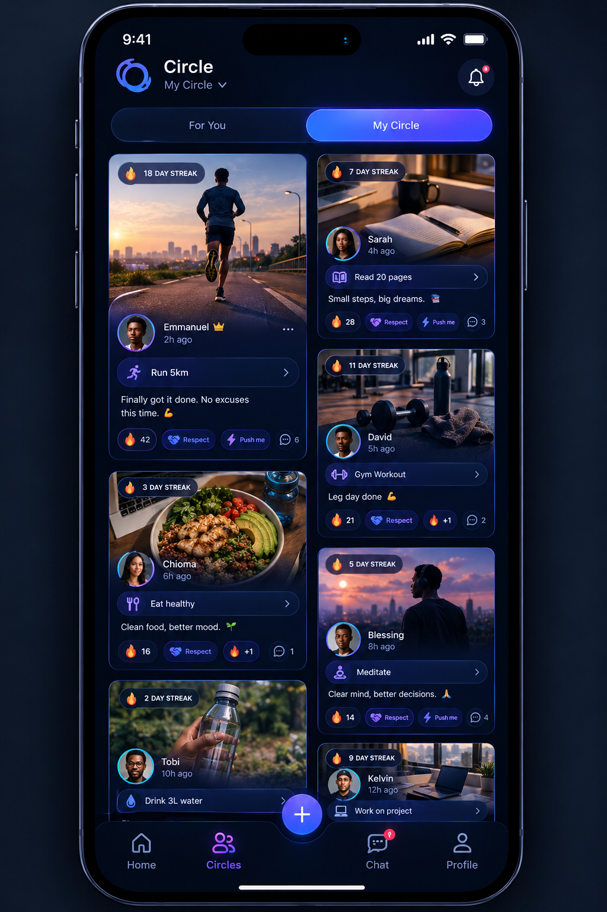

# ⭕ Circle

**"The social accountability partner that refuses to let you fail."**

Built for the **Build Something Real: The Serverpod Hackathon**.

  

---

## 🚀 The Vision
Standard habit trackers are too easy to ignore. WhatsApp groups meant for accountability get messy, and there’s no real penalty for slacking off. 

**Circle** is a dedicated productivity app built around strict social accountability. You don't just check a box; you prove it to your friends, climb the ranks, and if you miss your deadline, the app actively fights to keep you on track.

### 🌟 The Killer Feature: AGI Escalation Call
Circle doesn't just send you a passive push notification. If your deadline is approaching, Circle escalates:
1. **Gentle:** Push notification ("30 minutes left").
2. **Persistent:** Automated system message sent to your Circle group chat.
3. **Relentless:** The backend triggers a **VoIP AGI Phone Call**. Using Vapi and CallKit, your phone rings with a native call screen. When you answer, an AI drill sergeant demands to know why you haven't finished your habit.

---

## 🎨 UI & UX Architecture
The app combines the best visual patterns from modern social media to make accountability addictive:
* **Default View:** Pinterest-style asymmetric/masonry feed to beautifully display different sizes of proof photos.
* **Tap Interaction:** TikTok-style immersive full-screen proof viewer. This is where the "✅ Verify" and reaction buttons live for frictionless social interaction.
* **Profiles:** Circular progress/streak rings around avatars that fill up as you maintain your habits.
* **Top Navigation:** Swipeable `For You` · `My Circle` · `Leaderboard`.

---

## 🛠 Tech Stack
* **Backend:** Serverpod 4 (Dart)
* **Frontend:** Flutter
* **Database:** PostgreSQL
* **AGI Voice Integration:** Vapi (for in-app VoIP LLM calls)
* **Call UI:** Flutter CallKit (for native lock-screen ringing)
* **Animations:** Rive (Dynamic Mascot)

---

## 🏆 Why Serverpod? (Hackathon Alignment)
* **WebSockets / Real-Time:** The `Circle Chat` and `Reaction Verification` rely on Serverpod's seamless real-time data streaming.
* **FutureCalls (Scheduled Tasks):** The core AGI escalation mechanic uses Serverpod's `FutureCalls`. When a user sets a habit deadline, a FutureCall is scheduled. If no proof is verified by the deadline, Serverpod initiates the VoIP AGI call.

---

## 🏗 Core Database Schema
1. `User`: Tracks `streakCount`, `rankColor`, and `phoneNumber`.
2. `CircleGroup`: Tracks the group `dailyDeadline`.
3. `ProofPost`: Contains the `imageUrl` and `isVerified` status.
4. `Reaction`: Connects a `User` to a `ProofPost`.
5. `ChatMessage`: Powers the real-time chat.